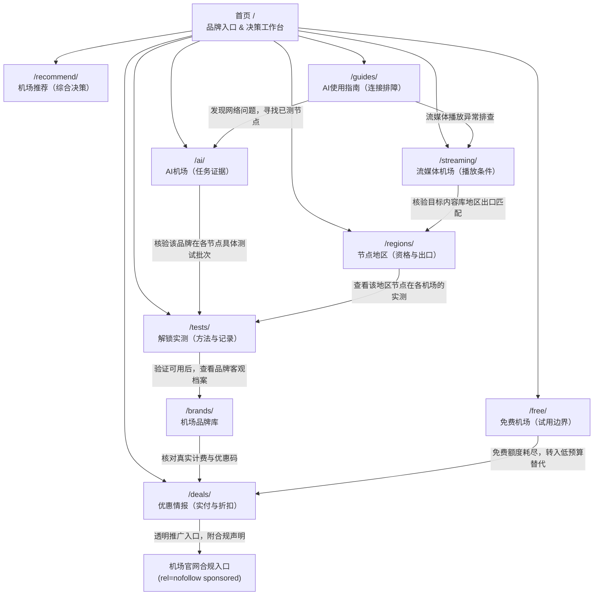

# aijichang.blog｜内链架构与拓扑导航关系图（INTERNAL_LINK_GRAPH）

> **设计目标**：构建层级分明、语义闭环、任务导向的网状内链系统。任何深层内容自首页出发不超过 3~4 次点击可达，杜绝孤儿页面与盲目全站互链。

---

## 一、站点核心导航拓扑（Topological Structure）

---

## 二、关键业务流转链路（User Journey Chains）

### 链路 1：AI 办公用户选型与排障闭环
1. 用户遇故障或寻求新机场：访问 `/guides/`（排查是否为官方账号/网络/DNS分流问题）。
2. 定位到需要更换支持 Claude / ChatGPT 的机场：流转至 `/ai/`。
3. 查看分平台任务矩阵（网页登录、多模态上传、流式输出）：点击对应测试记录流转至 `/tests/`。
4. 确认测试环境（运营商、测试日期、时延）满意：流转至 `/brands/[slug]/`。
5. 查看当前季度真实折扣与优惠码：流转至 `/deals/`。
6. 点击透明赞助入口完成订阅。

### 链路 2：流媒体与家庭多屏用户闭环
1. 用户想看 Netflix 4K 或 Disney+：访问 `/streaming/`。
2. 依据内容地区（美区/日区/港区）需求：点击地区链接进入 `/regions/` 核验官方版权与出口识别。
3. 查看高峰期持续带宽与缓冲测试：流转至 `/tests/`。
4. 权衡多设备连接数与大流量套餐：流转至 `/recommend/` 与 `/deals/`。

### 链路 3：免费试用防踩坑闭环
1. 寻求免费资源的用户：访问 `/free/`。
2. 了解零付款资源局限（试用额度生命周期、隐私与证书注入风险）。
3. 使用轻量任务验证方法（低消耗 AI 对话核查）。
4. 对比低预算月付（¥8~15/月）替代方案：流转至 `/deals/`。

---

## 三、内链锚点与 Canonical 规范

1. **唯一路径原则**：所有站内链接统一使用标准尾斜杠目录格式（如 `<a href="/ai/">`，严禁混用 `/ai`、`/ai/index.html` 或相对路径 `../ai`）。
2. **锚点平滑直达**：主入口页面包含对应 8 个二级专题的唯一 Anchor ID（如 `/ai/#a01`、`/recommend/#r01`），支持直接跳转对应知识模块。
3. **面包屑导航（Breadcrumbs）**：
   - 品牌页：`首页 > 品牌库 > 光速云`
   - 评测报告：`首页 > 解锁实测 > 测试记录详情`
   - 工具箱：`首页 > 交互工具箱 > AI流量预算计算器`
