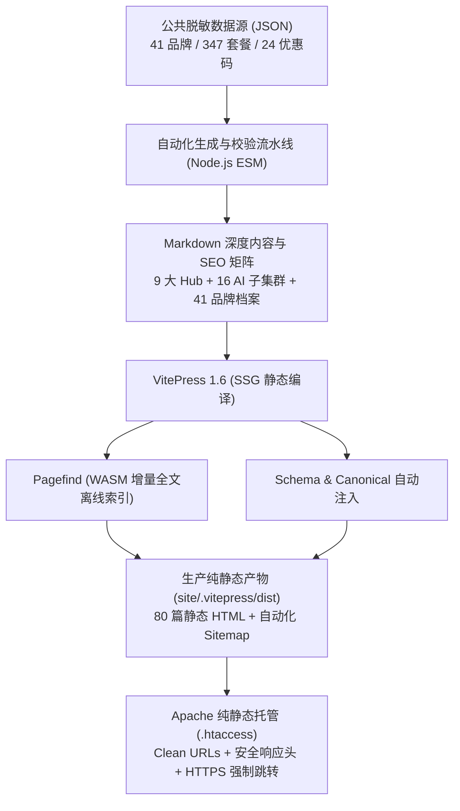

<div align="center">

# 🌐 aijichang.blog｜AI机场

**面向大语言模型（ChatGPT / Claude / Gemini）与高品质流媒体（Netflix / Disney+ / YouTube）的中文网络选型与客观实测知识库**

[](https://vitepress.dev/)
[](https://vuejs.org/)
[](https://www.typescriptlang.org/)
[](https://pagefind.app/)
[](./seo-health-report.md)
[](https://aijichang.blog/authors/lin-yue/)
[](./LICENSE)

[在线官网 (Production)](https://aijichang.blog) • [快速开始](#-本地开发与构建) • [核心架构](#-技术架构与选型) • [业务栏目](#-全站业务矩阵与导航) • [SEO & E-E-A-T](#-seo-与-e-e-a-t-体系) • [合规声明](#-商业披露与道德准则)

</div>

---

## 📖 项目定位与使命

很多代理与机场评测网站充斥着虚假营销、无脑置顶与千篇一律的模板排名。**aijichang.blog（AI机场）** 是一个建立在**真实数据、可复现实验与透明证据**基础上的专业技术知识库。

- **核心受众**：重度依赖 ChatGPT-4o / Claude 3.5 Sonnet / Google Gemini 的中文开发者、AI 研究员与出海企业团队，以及追求 4K HDR 原生画质的流媒体影音爱好者。
- **商业主线**：真实工程问题 → 平台风控白名单与物理任务条件 → 机场候选筛选 → 实测数据与品牌客观档案 → 真实账本精算与透明推广入口。
- **设计哲学**：简白（Clean White）品牌化风格、移动优先（Mobile-First）、极致加载性能、强逻辑排版，拒绝赛博朋克与霓虹监控屏风格。

---

## 🛠️ 技术架构与选型

本项目基于高性能纯静态架构构建，零多余动态服务端依赖，确保高并发下的极速响应与无死角搜索引擎抓取：



- **静态渲染引擎**：[VitePress 1.6](https://vitepress.dev/) + Vue 3 + TypeScript
- **全文搜索引擎**：[Pagefind](https://pagefind.app/)（纯静态离线 WASM 索引，毫秒级即时检索，内置 11 个一键检索热词胶囊）
- **动态端口防撞守护**：专属 `preview-server.mjs`，默认 4173，若遇同机多项目占用则自动智能顺延（4174+），彻底杜绝本地预览串台
- **部署环境**：Apache 纯静态交付，配备完善的 `.htaccess` 规则（301 强制 HTTPS、Clean URL 斜杠补齐、404 定向、WASM MIME 支持与安全标头）

---

## 🧭 全站业务矩阵与导航

全站内容严格遵循“一问一页、单层承接”的内容拓扑，涵盖 9 大核心业务 Hub 与 4 大辅助系统：

| 栏目路径 | 业务责任与定位 | 核心收录内容 / 特色 | 单页汉字量 |
| :--- | :--- | :--- | :---: |
| [`/`](https://aijichang.blog/) | **首页工作台** | 需求导流、分阶梯客观推荐看板（光速云、飞猫云、微风网络等） | 7,000+ 字 |
| [`/recommend/`](https://aijichang.blog/recommend/) | **机场推荐指南** | 综合比较不同预算、设备组合与使用场景的选型决策树 | 7,000+ 字 |
| [`/ai/`](https://aijichang.blog/ai/) | **AI机场专属专区** | ChatGPT、Claude 与 Gemini 任务可用性、长连接保持与 API 方案 | 7,700+ 字 |
| [`/streaming/`](https://aijichang.blog/streaming/) | **流媒体机场专区** | Netflix 4K 原生解锁、Disney+、YouTube Premium、TikTok 跨境电商 | 7,000+ 字 |
| [`/free/`](https://aijichang.blog/free/) | **免费机场核验** | 零付款资源真伪辨析、试用资格套路揭露与资金风控替代建议 | 7,000+ 字 |
| [`/regions/`](https://aijichang.blog/regions/) | **节点地区指南** | 香港/日本/新加坡/美区节点出口属性辨识与 ASN 白名单对照 | 7,000+ 字 |
| [`/guides/`](https://aijichang.blog/guides/) | **AI使用排障指南** | 首次连接验证、账户被封排查、流式输出中断、命令行 API 配置 | 7,000+ 字 |
| [`/tests/`](https://aijichang.blog/tests/) | **解锁实测中心** | 物理拓扑、真实任务闭环、晚高峰抗压与历史复测对比记录 | 7,100+ 字 |
| [`/deals/`](https://aijichang.blog/deals/) | **优惠情报精算** | 真实套餐付款核算（拒绝浮点错误）、优惠码兑现、资金沉没风险模型 | 7,100+ 字 |
| [`/brands/`](https://aijichang.blog/brands/) | **41 家品牌档案库** | 全量独立收录 41 家服务商详细参数、测速图、套餐表与 ToS 评估 | 汇编数据库 |
| [`/clients/`](https://aijichang.blog/clients/) | **全客户端矩阵** | Clash Verge Rev、Sing-box、Surge、Shadowrocket 等官方下载与配置 | 矩阵指南 |
| [`/reviews/`](https://aijichang.blog/reviews/) | **单品深度测评专栏** | 旗舰光速云 8,000 字全尺寸拆解与全网重点品牌深度报告 | 深度报告 |
| [`/tools/`](https://aijichang.blog/tools/) | **7 大决策工具箱** | 浏览器本地运行的流量计算器、跑路风险期望值估算器、ASN 匹配器 | 1,800+ 字 |
| [`/authors/`](https://aijichang.blog/authors/) | **E-E-A-T 作者档案** | 首席网络架构师「林越 (Lin Yue)」个人履历、工程背景与实测准则 | 专家档案 |

---

## 🔍 SEO 与 E-E-A-T 体系

本项目已完成全方位的“预防性 SEO 健康检查与基础设施优化”，健康评分为 **97.6 / 100（S级·卓越）**：

1. **规范 Canonical（100% 覆盖）**：
   全站 80 篇静态 HTML 均通过 [`schema-helper.ts`](./site/.vitepress/schema-helper.ts) 自动注入标准 `<link rel="canonical">` 标签，实现绝对自引用，杜绝权重分散。
2. **丰富的 Schema.org 结构化数据（143 组 JSON-LD）**：
   - 全局注入 `BreadcrumbList` 面包屑导航；
   - 首页注入 `WebSite` 与 `SearchAction`；
   - 各核心专题注入 `CollectionPage`；
   - 评测页注入 `Review` 与 `Product`（含星级、测试人、品牌元数据）；
   - 技术指南注入 `TechArticle`；
   - 关于页面注入 `Organization`。
3. **E-E-A-T 专家透明体系**：
   - 建立首席评测工程师「林越 (Lin Yue)」完整履历档案（10 年跨国专线与云计算网络运维背景）；
   - 每篇文章头部展示核验时间与作者署名，文末常驻实测资质背书卡片；
   - 5 大信誉底座页全量在线：[关于我们](/about/)、[四层评测方法论](/methodology/)、[商业披露声明](/disclosure/)、[更正与勘误归档](/corrections/)、[隐私政策](/privacy/)。
4. **爬虫友好型 Robots.txt**：
   显式配置 `Googlebot`、`Bingbot`、`Baiduspider` 与神马/夸克/UC 搜索的 `yisouspider` 友好放行规则。

---

## 💻 本地开发与构建

### 环境要求
- **Node.js**：`^18.0.0 || >=20.0.0`（推荐 LTS 20+）
- **包管理器**：`npm`（工作区自带 `package-lock.json`）

### 常用命令

```bash
# 1. 克隆代码仓库
git clone https://github.com/opopop98698-sudo/aijichang.blog.git
cd aijichang.blog

# 2. 安装项目依赖
npm install

# 3. 启动本地开发热更新服务器 (默认端口 5173)
npm run dev

# 4. 执行全套构建流水线 (数据核验 -> 内容字数审计 -> VitePress 打包 -> 资产同步 -> Pagefind 索引 -> 离线审计)
npm run build

# 5. 启动智能生产预览服务器 (带智能动态端口探测，防止与其他工程冲突)
npm run preview
```

### 离线质量守护脚本
- `npm run validate:data`：校验 41 家品牌、347 档套餐与跨实体外键完整性；
- `npm run validate:content`：严格审查 9 大主入口 7,000~15,000 字字数要求及站内 270+ 链接连通性；
- `npm run audit:dist`：全量扫描输出产物，检查 HTML 完整性、Robots、Sitemap 与 404 资源死链。

---

## 📂 项目代码目录结构

```text
aijichang.blog/
├── data/                       # 公开脱敏数据集与结构化字典
│   ├── public/                 # 41 品牌、套餐、优惠券、外链、平台任务数据
│   └── internal/               # 内部任务分类与拓扑对照
├── deploy/                     # 生产部署基础设施配置
│   └── apache/                 # Apache .htaccess (HTTPS强制/CleanUrls/安全标头)
├── scripts/                    # 自动化数据处理、内容生成与离线审计流水线
│   ├── build-public-data.mjs   # 数据集组装
│   ├── finalize-dist.mjs       # 构建后资产整合与 robots 同步
│   ├── preview-server.mjs      # 智能动态端口预览引擎 (防串台)
│   ├── validate-content.mjs    # 汉字量与内容规范校验
│   └── audit-dist.mjs          # 生产产物 0 错误全合规审计
├── site/                       # VitePress 源码主目录
│   ├── .vitepress/             # 站点配置、全局样式与主题组件
│   │   ├── config.ts           # 站点元数据、导航与侧边栏配置
│   │   ├── schema-helper.ts    # Canonical 与 Schema.org JSON-LD 注入器
│   │   └── theme/              # Vue 3 核心组件库与品牌样式
│   ├── public/                 # 纯静态资源 (WebP Logo、测速大图、robots.txt)
│   ├── index.md                # 首页看板
│   ├── recommend/              # 机场推荐主专题
│   ├── ai/                     # AI机场与 16 篇三级细分子文章
│   ├── streaming/              # 流媒体 4K 播放专题
│   ├── free/                   # 免费与试用核验专题
│   ├── regions/                # 节点地区与出口识别指南
│   ├── guides/                 # AI 连接与排障实战手册
│   ├── tests/                  # 四层客观解锁实测中心
│   ├── deals/                  # 真实套餐账本与优惠情报
│   ├── brands/                 # 41 家品牌全量档案库
│   ├── clients/                # 全平台客户端矩阵
│   ├── reviews/                # 单品深度测评与拆解报告
│   ├── tools/                  # 7 大交互决策工具箱
│   └── authors/                # 专家团队与作者档案
├── .env.example                # 搜索引擎站长平台 Meta 验证环境变量模版
├── package.json                # 工程依赖与流水线指令
├── seo-health-report.md        # 预防性 SEO 健康体检报告 (97.6分)
└── README.md                   # 项目工程说明文档
```

---

## ⚖️ 商业披露与道德准则

1. **联盟链接合规标记**：全站所有指向服务商的商业推广直达链接，一律显式包含 `rel="nofollow sponsored noopener"` 属性，严格遵循各大搜索引擎站长准则，不传递 PageRank，防范算法惩罚；
2. **零特权测试原则**：所有评测均使用普通用户身份自费下单，绝不采用商家定制的特权节点；实测发现丢包或断流，均如实归档存证，绝不做选择性隐瞒；
3. **佣金独立性声明**：商业佣金由服务商市场推广预算支出，用户通过推广链接购买不承担任何额外费用；本站与任何品牌方无股权或排他性隶属关系。

---

<div align="center">

**Copyright © 2026 AI机场 [aijichang.blog](https://aijichang.blog). All Rights Reserved.**  
*遵循简白、移动优先、客观可追溯与事实归因原则*

</div>
